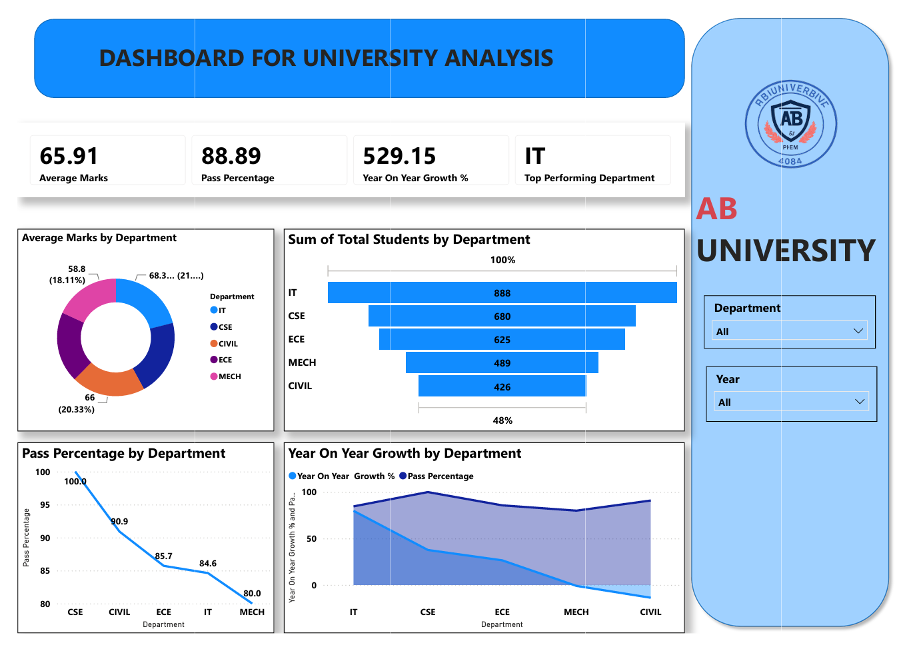

# University Analytics Dashboard

An interactive **Power BI dashboard** designed to analyze university enrollment data and student academic performance across different departments and academic years.

This project demonstrates practical skills in data visualization, data analysis, data transformation, and dashboard development using Microsoft Power BI.

## Project Overview

The dashboard uses university-related data to explore student enrollment patterns and academic performance across departments.

The dataset contains two main sections:

- **Enrollment:** Student enrollment distribution across departments and years.
- **Results:** Student examination marks and department-wise performance.

## Dataset

**File:** `University_PowerBI_Dataset.xlsx`

The dataset contains two worksheets:

| Worksheet | Columns | Description |
|---|---|---|
| Enrollment | Year, Department, Total Students | Department-wise student enrollment across years |
| Results | Student ID, Department, Marks | Student examination marks and department information |

## Dashboard

The Power BI report provides a visual interface for exploring university enrollment and academic performance data.

### Dashboard Preview

## Project Files

| File | Description |
|---|---|
| `University_Analytics_Dashboard.pbix` | Power BI dashboard report |
| `University_PowerBI_Dataset.xlsx` | Source dataset |
| `screenshots/DASHBOARD.png` | Dashboard screenshot |
| `README.md` | Project documentation |

## Tools & Technologies

- Microsoft Power BI Desktop
- Power Query
- DAX
- Microsoft Excel
- Data Visualization
- Data Analysis

## Skills Demonstrated

- Data cleaning and transformation
- Exploratory data analysis
- Data modeling
- Interactive dashboard development
- Academic performance analysis
- Department-wise data analysis
- Data visualization and reporting

## Purpose

This project demonstrates the application of business intelligence and data visualization techniques to university-related datasets.

It is part of my growing Power BI portfolio, showcasing practical experience in transforming raw data into meaningful visual reports.

## Author

**Pranay Patil**

[GitHub Profile](https://github.com/Pranay-Pandurang-Patil)

## License

This project is intended for educational and portfolio purposes. Dataset ownership and redistribution rights should be verified before reuse.